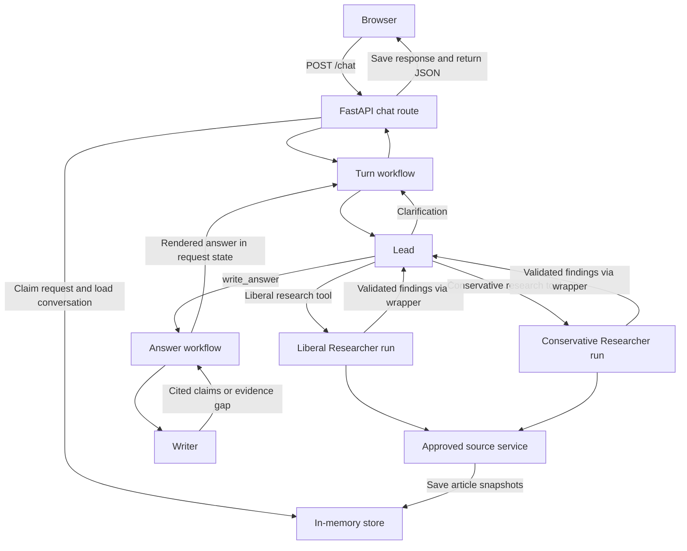

# Gerry codebase guide

Gerry compares how selected liberal and conservative U.S. news outlets covered
the same specified international event. A reader can ask a question, narrow it
with a follow-up, and open the excerpts behind the answer's citations. The
application reports patterns in the retrieved sample. An inaccessible article,
a thin sample, and an aspect absent from the articles are different findings
with different implications.

This guide describes the current Phase 4 implementation. For the changes that
produced this layout, see the [simplification log](SIMPLIFICATION_LOG.md). For
future scope and earlier design decisions, see the [implementation plan](IMPLEMENTATION_PLAN.md)
and [product decision record](GRILLING_SESSION_SUMMARY.md).

## 1. Repository map

| Area | What it owns |
| --- | --- |
| `main.py` | Load runtime settings, assemble the app, and start Uvicorn. |
| `src/frontend/` | HTML, CSS, browser chat state, progress, and the presentation of Markdown and source excerpts. |
| `src/backend/interfaces/http/` | FastAPI routes, request and response schemas, and Server-Sent Events. |
| `src/backend/application/` | Settings, dependency assembly, turn orchestration, shared budgets, evidence selection, answer policy, and rendering. |
| `src/backend/agents/` | Lead, Researcher, and Writer definitions, prompts, tool wrappers, and structured outputs. |
| `src/backend/sources/` | Approved outlet roster, publisher discovery, network access, article extraction, and saved-evidence access. |
| `src/backend/infrastructure/persistence/` | Process-local conversations, request records for replay, and article snapshots. |
| `tests/` | Contracts, workflow behavior, HTTP, storage, and source fixtures. |

The application packages follow the main data flow. `turn/` runs the request,
`evidence/` determines which saved material is eligible, and `answer/` uses
that material to produce the briefing. The agents call application services
for work such as validating evidence and preparing an answer. The HTTP adapter
owns the lifecycle of a submitted request and invokes the turn workflow.

## 2. Startup and dependencies

`main.py` loads typed `Settings` from the environment. The default model
identifier is `vertex_ai/gemini-3.5-flash-lite` and the default Vertex location
is `global`. The Vertex project is an optional override. A model identifier
outside the configured Vertex prefix requires `GEMINI_API_KEY` under the
current settings rules. The example environment file documents the supported
overrides. The app reads exported variables. [Entry point](../main.py) ·
[Settings](../src/backend/application/settings.py) · [Environment example](../.env.example)

The composition root creates a store and an `ArticleSourceService` that uses
it, then injects both into FastAPI along with one model instance and its
settings. Agent instances are built for their runs around that shared model.
The Agents SDK drives model and tool execution. LiteLLM adapts the configured
provider. Pydantic validates schemas at the HTTP, agent, and source boundaries.
The model is injectable, which is how the backend suite runs with scripted
replies. Loading the page or checking health makes no model call.
[Composition root](../src/backend/application/composition.py) ·
[Dependency manifest](../pyproject.toml)

## 3. Browser and HTTP boundary

FastAPI serves `index.html` at `GET /` and browser assets under `/static`.
`chat.js` owns the visible transcript, current conversation ID, current
submission, and retry payload. It checks `GET /health` to decide whether to show
the chat form. The health check reports application availability independently
of model credentials and publisher access.

When the reader sends a message, the browser trims it, generates a request ID,
and builds a payload containing the full visible transcript plus the new user
message. It displays the pending question, opens an `EventSource`, and posts
the payload to `/chat`. On success it adds the submitted question and answer to
the transcript and saves the returned conversation ID in memory. On a dropped
or invalid response, or a running-request conflict with `Retry-After`, the UI
offers a retry using the same payload. Starting a new chat clears the browser's
conversation ID and transcript. Refreshing also clears browser state, while
the server's records live for the rest of that process.
[HTML page](../src/frontend/index.html) · [Browser logic](../src/frontend/static/chat.js)

### Chat request and response

| Field | Meaning |
| --- | --- |
| Request `conversation_id` | Null for a first turn. An existing ID identifies the server-side transcript and evidence for a follow-up. |
| Request `request_id` | Identifies this particular submission across retries. A new question gets a new ID. |
| Request `messages` | A nonempty list of alternating user and assistant messages that begins and ends with a user message. |
| Response `conversation_id`, `request_id` | Identify the conversation and submission for the returned result. Handled errors echo available identifiers. |
| Response `answer` | Reader-facing Markdown, a clarification question, or an error explanation. |
| Response `tool_calls` | Ordered tool records with agent, tool, outcome, and optional error. |

The route validates the request before claiming work. For a claimed turn it
builds fresh request state, invokes `run_turn()`, and converts the result to a
`ChatResponse`. A blank answer becomes invalid output. The route saves the
response for replay before returning it. Handled failures keep the same
response shape.

| Condition | What the HTTP layer returns |
| --- | --- |
| Invalid request shape or message sequence | `422` with a safe explanation. |
| Unknown conversation ID | `404` asking the reader to start a new chat. |
| Changed payload for a reused request ID, mismatched history, or a different active request in that conversation | `409`. |
| Same request still running | `409` with `Retry-After: 1`. |
| Same request already completed | Its saved body and HTTP status. |
| Same request interrupted | `409` explaining that a new submission is needed. |
| Research limit reached | The available answer, a cited partial answer, or a limit explanation. These results use `200`. |
| Invalid agent output, unexpected execution error, or response persistence failure | A reader-facing message with the mapped status. These paths currently use `502`, `500`, and `503` respectively. |

The application failure map also defines other categories for the workflow.
Source-level failures such as a paywall usually contribute to findings or
answer limitations instead of deciding the HTTP status of the whole turn.
[Chat contracts](../src/backend/interfaces/http/chat_contracts.py) ·
[HTTP routes](../src/backend/interfaces/http/app.py) ·
[Failure categories](../src/backend/application/turn/failure_category.py)

### Live progress

The progress route observes a request by its ID. The POST route publishes
`agent_started` when the Lead begins, `tool_finished` when the tool recorder
receives a record, and `agent_finished` before attempting to save the response.
The last event marks the end of workflow processing. The POST response remains
the source of the final answer and its status.

Progress events have a type, agent, message, and UTC timestamp. The HTTP
adapter keeps them in a separate process-local list for each request. The
stream assigns sequential event IDs, resumes after a valid `Last-Event-ID`,
and waits briefly for a POST that has yet to claim the request. It drains
available events and stops after completion or interruption. The browser
updates the progress label while the POST is pending and closes the stream
when the POST settles. [Progress route](../src/backend/interfaces/http/app.py) ·
[SSE event model](../src/backend/interfaces/http/progress_event.py)

## 4. Session and persistence model

The app has three different scopes for state.

| Scope | What lives there |
| --- | --- |
| Conversation | The authoritative visible transcript, saved article snapshots, optional saved brief and findings, and the current active request ID. |
| Request record | The claimed payload, conversation ID, running/completed/interrupted status, and an optional saved response and HTTP status. |
| Live `RequestState` | A fresh deadline and counters, tool-call recorder, Researcher semaphore, round counts, Writer call count, failed reads, working brief and findings, and any rendered answer for the turn. |

`InMemoryStore.begin_request()` checks the request-ID index first. This allows a
retry of the first POST to find its original conversation even though the
payload still has a null conversation ID. For a new request, the store checks
that all submitted messages before the final question exactly match the
conversation's saved transcript. It also checks that the conversation has no
active request. A single lock protects the claim and state transitions.

On completion, the store saves the response and status for replay, then the
conversation is available for new work. A response below HTTP 400 appends the
user message and assistant answer to history. A failed HTTP response is
replayable without changing that history. Interruption releases the active
slot and preserves the interrupted request record. Article and research
writes happen during the workflow, independently of whether the final
response gets appended. A later turn can therefore have saved evidence even
if a previous answer failed to finish.

`build_request_state()` loads the conversation's saved brief and findings
when available and groups them for the new turn. It creates a fresh budget and
recorder. Gerry passes that state to the SDK as Python run context and supplies
model input explicitly for each agent. There is no SDK `session=` in the
runner call. Server-side continuity comes from the app's transcript and
research records. In-memory data is local to one backend process and disappears
when that process exits. [Store](../src/backend/infrastructure/persistence/memory.py) ·
[Request state](../src/backend/application/turn/request_state.py)

## 5. End-to-end agent workflow



### Lead

`run_turn()` builds a Lead agent with the current date in its instructions
and passes the validated visible history as model input. The Lead's output
schema wraps a `ResearchBrief`. A clarification brief requires a question.
A clear brief requires a start and end date in order.

The Lead can call `research_liberal_coverage`, `research_conservative_coverage`,
and `write_answer`. They are SDK function tools implemented as Python wrappers
that start nested runs. The Lead retains control of the overall turn and receives
the results of its calls. Each wrapper gets `RequestState` through SDK context.

For initial research, a Lead hook requires the first tool batch to contain the
two research tools with matching broad arguments. The first accepted research
call fixes the event and date window. Later calls must use the same brief.
The two research runs can overlap under the request semaphore. The Lead may
send a neutral follow-up to either group within its round allowance. Writer
calls run on their own tool batch. To finish a clear brief, the Lead must
return the brief that was used for research and have an answer already stored
in request state.

For a follow-up with saved research, the Lead prompt includes the saved brief
and findings. The Lead may call the Writer directly when those findings suffice
or use targeted research within the same event and window.
[Turn entry point](../src/backend/application/turn/run_turn.py) ·
[Lead setup](../src/backend/agents/lead/agent.py) · [Lead tools](../src/backend/agents/lead/tools.py) ·
[Brief schema](../src/backend/agents/research_brief.py)

### Researcher

The two groups use the same Researcher definition, prompt, and output schema.
Each round builds a fresh run with an assignment message containing the event,
group, approved outlets, inclusive publication dates, and optional focus question.
It shares trusted Python state and budgets with the other agents. Its model
input starts with the assignment and accumulates its own tool calls and
results. The other group's findings are not injected into this input.

| Researcher tool | Model arguments | Restrictions and result |
| --- | --- | --- |
| `search_articles` | Query text | The wrapper supplies the window and assigned outlets, charges one search unit, and returns candidates and an outcome per outlet. |
| `read_article` | Article URL and outlet ID | The wrapper checks assignment and supplies the conversation, dates, and outlet restrictions. Each attempt charges a read unit. Only `FETCH_FAILED` results are retried. Success returns a saved article and its passages. |

Blocking source operations run in worker threads so two Researchers can overlap.
A search is logged as successful if at least one outlet returns a successful
discovery result or reports no matches. An article read is logged once after
its final attempt. Failed reads are also retained for the answer's limitations.

The output contains an article inventory, central focuses, attributed accounts,
supporting passage IDs, and limitations. The schema requires each cited
article to appear in that inventory. The validator then checks the inventory
against saved articles in the conversation using the assigned source group,
and checks that each passage belongs to its cited article. Validation can use
same-group evidence saved in earlier rounds in that conversation. Accepted
findings are labeled with the trusted group, returned to the Lead, and saved
for follow-ups. [Researcher agent](../src/backend/agents/researcher/agent.py) ·
[Source tool policy](../src/backend/agents/researcher/tools.py) ·
[Findings schema](../src/backend/agents/researcher_findings.py) ·
[Findings validation](../src/backend/application/evidence/findings_validation.py)

### Writer and answer policy

The Lead calls `write_answer` with the reader's question and an alignment
table. Each row labels an aspect as a central focus, a passing mention, or
absent in each group's sample. Central and
incidental treatments require passage IDs. The answer workflow checks those
citations against the group they describe before invoking the Writer.

The workflow joins accepted findings to saved articles by ID, deduplicating
references within each group. Python chooses the answer mode from the articles
available to each group.

| Evidence available | Answer mode |
| --- | --- |
| Usable articles on both sides | Comparison. A group below two reporting articles from two distinct outlets is marked thin. Unequal samples are kept and described. |
| Usable articles on one side only | Objective summary of the available coverage. Overlap and differences are rejected in this mode. |
| No usable articles | A no-coverage explanation with any recorded read failures. This path skips the Writer model. |

The Writer sees the question, event, mode and sample, alignment, findings, and
saved article passages. Its one tool, `read_collected_article`, looks up a saved
article by ID in the current conversation. It can return metadata such as
bylines and publication dates along with the passages. It does not contact a
publisher.

The Writer returns a report with cited summary claims and, when allowed,
overlap and differences. It can instead request a specific evidence gap.
Python checks that the claims cite known passages and follow the answer mode.
These checks establish provenance and structure. The model is instructed to
make claims the passages support, but the validator does not independently
fact-check or establish that a claim follows from the passage. On success the
application renders Markdown, stores it in `state.final_answer`, and returns
status and mode to the Lead. If the Writer names an evidence gap, the Lead
receives that gap and can use its remaining research allowance.
[Evidence selection](../src/backend/application/evidence/collected_evidence.py) ·
[Sample assessment](../src/backend/application/answer/sample_assessment.py) ·
[Writer workflow](../src/backend/application/answer/write_answer.py) ·
[Writer agent](../src/backend/agents/writer/agent.py) · [Writer report](../src/backend/agents/writer/schemas.py)

### Runner, correction, and limits

All three roles invoke `run_with_correction()`. It calls `Runner.run()` with
the agent, that run's model input, the current `RequestState`, and an SDK turn
ceiling. A hook charges each model invocation to the shared request budget.
The wrapper allows one correction attempt. A structured result that fails
application validation can carry its tool results into the correction. When
the SDK raises a model behavior error without returning a result, the
correction starts from the input already available to the wrapper.

| Default | What it limits |
| --- | --- |
| 300 seconds | Request deadline. The outer Lead wait uses the remaining time, and the budget also checks it before consuming a resource. |
| 40 model calls, 20 searches, 30 article-read attempts | Shared per-request ceilings across the Lead, Researchers, Writer, and corrections. |
| 3 research rounds per group, 2 concurrent Researchers | The group round allowance and the request semaphore. |
| 2 article-read retries | Additional attempts after a fetch failure, subject to the shared read budget. |
| 8 Lead turns, 12 Researcher turns, 4 Writer turns | SDK turn ceilings for each runner attempt. |
| 2 Writer tool calls | How often the Lead can ask the application to write in one request. |
| 4,096 output tokens | Output ceiling forwarded in model settings. |

The composition root disables LiteLLM retries through model settings and
configures the source fetcher with zero retries for the assembled app. This
keeps article retries visible to the application budget and leaves structured
corrections with the shared runner. Blocking source operations have separate
network bounds.

If the turn hits a budget, SDK turn limit, or timeout that reaches
`run_turn()`, it returns a rendered answer if one exists. Otherwise it can
use articles named in accepted findings to list cited headlines and explain
the limit. With no eligible evidence, it returns the research-limit message.
A limit reported inside a Researcher tool or a Writer step-limit failure can
also reach the Lead as a tool result, allowing the Lead to continue if the
request budget permits. [Shared runner](../src/backend/application/turn/structured_run.py) ·
[Request budget](../src/backend/application/turn/request_budget.py) ·
[Turn fallback](../src/backend/application/turn/run_turn.py)

## 6. Publisher access and collected evidence

### Roster and discovery

The fixed roster assigns each outlet a stable ID, display name, source group,
publisher feed and hosts, and classification provenance. Research tools
derive group membership from this roster. The service restricts article reads
to the outlet's exact article hosts. Discovery can also use the feed hosts
needed for the assigned outlet.

Discovery uses current feeds when the end date is at least as recent as seven
days before the current UTC date. For older windows, it can use NBC's monthly
archive, CBS's monthly article sitemaps, and the New York Post's daily archive.
Other outlets fall back to current feeds with a qualifier about historical
coverage. Discovery parses RSS or Atom entries, sitemap URLs, or archive links.
It filters video paths, matches terms against titles or snippets, checks known
publication dates, and keeps a bounded set of candidate URLs per outlet.
Candidates may have an unknown date. The read path must verify a date before
collecting the article. [Outlet roster](../src/backend/sources/outlets/roster.py) ·
[Discovery](../src/backend/sources/discovery.py)

### Network and extraction boundaries

Every outbound source URL must use HTTPS on an allowed exact hostname and the
default port. Credentials in the URL and whitespace are rejected. Redirect
destinations go through the same checks. DNS answers must be public, and the
connection uses a checked IP with the publisher hostname for TLS verification.
The fetcher bounds redirects, response bytes, and network time. The service
also validates the returned URL, status, and size before parsing the document.
[HTTP fetcher](../src/backend/sources/access/http.py)

For an article read, the service checks the outlet and URL before looking for
a matching saved snapshot by requested or canonical URL. It checks the
publication window on reuse. For a fresh read it requires an HTML response
and uses Trafilatura to extract the article body and title. It checks publisher
metadata for gates, validates explicit publication dates and rejects conflicting
calendar dates, and records details such as bylines, article type, and likely
wire origin when available. Short extracts, missing dates, and inaccessible
articles have distinct failure statuses. The service only returns a successful
read once a usable snapshot already exists or has been saved.
[Source service](../src/backend/sources/service.py) ·
[Article extraction](../src/backend/sources/articles/extraction.py)

### Snapshots and duplicates

An `ArticleRecord` has a UUID, outlet, requested and canonical URLs, title,
dates and other available metadata, and ordered passages. Each passage ID
embeds the article UUID and paragraph number, for example
`<article-uuid>:p0001`. The stable IDs carry evidence from the Researchers to
the Writer and renderer. Search candidates have a separate result type because
they have not gone through a full read and save.

The service compares article text with snapshots already collected in the
conversation. A substantially shared text can be marked with `duplicate_of`
using overlap between five-word sequences. Separate outlet records still
represent separate publication choices. A same-outlet, same-canonical-URL
match can reuse the saved record when its text matches. The store also checks exact
whitespace-normalized text under its lock so concurrent reads can preserve
duplicate relationships. Reused snapshots retain the IDs that earlier
findings cited. [Article contract](../src/backend/sources/articles/contracts.py) ·
[Access contracts](../src/backend/sources/access/contracts.py) ·
[Article storage](../src/backend/infrastructure/persistence/memory.py)

## 7. Rendering and citation behavior

The renderer builds the briefing from the structured report, validated
alignment, sample assessment, and recorded failed reads. It can produce the
summary, comparison table, overlap, differences, limitations, and source list.
It omits comparison sections when only a summary is supported and omits a
table if there are no alignment rows. A no-coverage result has its own simpler
layout.

A reference like `[2]` identifies an article in the rendered answer. Numbers
follow first citation order across the sections. Several passages from the
same article reuse its number. The source entry displays the outlet, linked
article title, available publication date, and type where appropriate. Its
excerpt comes from the article's first cited passage, shortened to at most
24 words plus an ellipsis if needed.

The browser renders the briefing with the locally bundled Markdown parser and
raw HTML disabled. It places the sources section in an expandable panel,
connects numbered markers to the corresponding entries, and opens the panel
when a reader clicks a citation. It gives each answer its own citation
targets and wraps tables in a scrollable region. The article URL remains a
separate link in the source entry. [Answer renderer](../src/backend/application/answer/answer_rendering.py) ·
[Browser rendering](../src/frontend/static/chat.js)

## 8. Examples to trace in the code

### First question and clarification

A reader asks for coverage without naming a usable publication period. The
browser submits a first-turn payload. The store creates a conversation, and
the Lead can return a clarification brief. The route saves the question and
clarifying answer as the first visible exchange. The next POST includes both
messages and the new user reply. Once the event and dates are clear, the Lead
can launch the two research tools.

### Comparison and follow-up

The initial research pair searches and reads approved outlets. Accepted
findings give the Lead passage IDs for its alignment. The answer workflow
checks that alignment, passes the evidence to the Writer, and returns the
rendered answer through the POST route. On a follow-up, the Lead receives the
visible transcript and saved research, so it can ask the Writer to explain a
specific point using the same evidence or ask a Researcher to fill a gap.

### Lost response and retry

A response may be lost after the server completed the request. The browser
resends the same request ID and payload. The request lookup returns the saved
response and status. If the initial POST is still running, the route instead
returns a retryable conflict. A second question submitted under a different ID
cannot overlap an active turn in the same conversation.

## 9. Running and verifying the implementation

Start Gerry from the repository root.

```bash
uv sync --frozen
LITELLM_LOCAL_MODEL_COST_MAP=True uv run python main.py
```

The default address is `http://127.0.0.1:8080`. The app serves its own static
assets. Live chat with the default Vertex model requires Google Application
Default Credentials. Follow the [README](../README.md) for local configuration.

Run the default test suite from the same directory.

```bash
LITELLM_LOCAL_MODEL_COST_MAP=True uv run pytest
```

The default suite uses scripted model responses and fixture source data. The
most useful places to trace behavior are the turn tests for agent sequencing
and correction, the HTTP tests for chat and replay, the store tests for
conversation isolation and concurrency, and the source tests for retrieval and
extraction rules. The live marker is opt-in. Passing the default suite does not
establish current availability at individual publishers.
[Scripted model](../tests/support/scripted_model.py) ·
[Turn tests](../tests/backend/application/test_run_turn.py) ·
[HTTP tests](../tests/backend/interfaces/http/test_app.py) ·
[Store tests](../tests/backend/infrastructure/test_memory_store.py) ·
[Source tests](../tests/backend/sources/test_source_service.py)

The current workflow centers on a specified event with bounded publication
dates and follow-up questions about that event. Historical discovery is bounded
and publisher-specific. The implementation uses one process-local store for
sessions. Recent-event suggestions, durable multi-instance storage, and
deployment validation belong to later phases in the [implementation plan](IMPLEMENTATION_PLAN.md).
