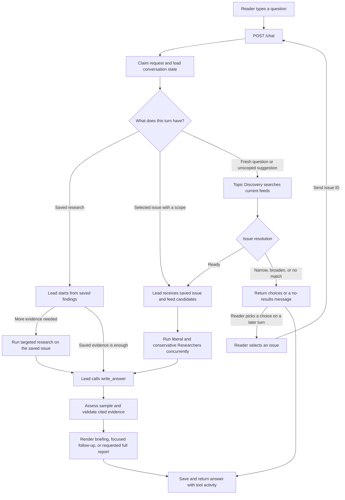

# Gerry session changelog

November 17–18, 2026 · All times and dates are in Eastern Time unless specified.

Gerry moved from comparing coverage of individual headlines to comparing how selected liberal and conservative outlets cover a **bounded world issue**. This document records the product decisions, how they map to the current code, and what we verified. It includes intermediate changes where they explain the final design.

## Product decisions

- **Unit of comparison.** Choose an issue broad enough to support several related angles and specific enough to define which articles belong. Examples from our discussion include Russia’s war in Ukraine, China-linked cyberattacks on the U.S., and Egypt’s involvement with Palestine. A country name is a starting point for narrower options. A single headline is a starting point for suggesting a broader issue.
- **What the reader learns.** Open with the key facts in the recent coverage and enough background to make sense of them. Then explain what the sampled outlets made central, what they shared, and where their emphasis differed. When the samples show similar priorities, say that there was no meaningful difference in emphasis in those articles. That finding is limited to the coverage Gerry sampled.
- **Evidence for an aspect.** An aspect qualifies when it is a main point of even one sampled article. Name the outlet that gave it prominence. An article’s passing mention can help explain the other side of a card. Thin or uneven samples get a small count footnote. A comparison can still be useful when only one outlet represents a group, and Gerry explains the limitation when only one side has usable coverage.
- **Scope and interaction.** Continue using current publisher feeds. An older article can still be eligible if it is present in a current feed. Date ranges requested in chat get an explanation of the feed scope. A focused follow-up gets a focused answer. A full report requires an explicit request.

## Issue discovery and research

### Topic agents and application routing

We inspected the original Topic Planner and Topic Clusterer and confirmed that Python ran them as standalone structured model calls before the Lead. The activity log had attributed the headline search and grouping to `lead`. We first corrected those entries to `topic_planner` and `topic_clusterer`. The later consolidation replaced both with a single `topic_discovery` agent.

- The combined agent plans a short feed query, invokes the callable `search_recent_events` tool, and returns its grouping as structured output. The application records the grouping outcome as `group_topics`. Both activity entries use `topic_discovery`. Grouping is the agent’s output, with the activity entry serving as a readable progress record. [Agent builder](../src/backend/agents/topics/agent.py) · [Tool and grouping log](../src/backend/application/turn/topic_step.py)
- The old `planner_prompt.md` and `clusterer_prompt.md` were replaced by one [discovery prompt](../src/backend/agents/topics/discovery_prompt.md). [Topic schemas](../src/backend/agents/topics/schemas.py) define a label, a scope description, numbered candidate references, and a resolution. `ready` sends one well-scoped issue to the Lead, `narrow` offers narrower choices, and `broaden` offers a broader issue to confirm.
- The application still controls the transition to research. `run_turn()` handles a published selection, fresh discovery, or a follow-up using saved research. Fresh discovery returns choices or a resolved issue. Published issues with expired IDs prompt the reader to search again. The exact legacy text-only selection format remains accepted for compatibility. [Turn routing](../src/backend/application/turn/run_turn.py)

### Feed-only search and fallback suggestions

The Egypt investigation showed why the old date control was misleading. A six-month filter ending today still downloaded current feeds. On a local replay, the search found one Egypt headline, which did not form a two-outlet comparison topic, and the broader fallback suggested other stories that could have zero search terms in common with Egypt. We decided to make recent-feed lookup the product and keep archives outside the chat workflow.

- Discovery no longer accepts user-controlled start and end dates in its tool. It accepts `date_filter_requested` so the response can explain the scope and continue searching the named subject. The application uses an internal lower bound of `date.min` to select the full current-feed path and caps publication dates at the query day. The lower-level archive implementation remains in the repository. [Discovery workflow](../src/backend/application/turn/topic_step.py) · [Feed scope constant](../src/backend/sources/constants.py) · [Source URL selection](../src/backend/sources/discovery.py)
- The query can include the primary phrase and up to four alternative phrasings. The source matcher treats them as alternatives and checks each against the feed title and snippet. This helps include coverage that uses different wording. Matching remains lexical within each phrase. Unfiltered current-feed discovery supplies the broader candidate pool without the per-outlet cap used for filtered results. [Source matching](../src/backend/sources/discovery.py) · [Candidate collection and caps](../src/backend/sources/service.py)
- When a named subject has no usable comparison topic, chat groups unfiltered feed candidates and offers up to three topics, ranked by distinct outlet count and then recency. The message invites the reader to choose one. Chat retains a word-overlap fallback when model grouping fails. Selecting a fallback without a scope description sends it through discovery again. [Fallback workflow](../src/backend/application/turn/topic_step.py) · [Topic ranking](../src/backend/application/evidence/topic_clusters.py) · [Choice copy](../src/backend/application/answer/answer_rendering.py)

### Recent Issues and the handoff to research

The front page previously used one publisher’s headline as a clickable research question. That could even concatenate unrelated stories, as in the example that combined a diplomatic trip with Nvidia. The new path keeps the issue and its sources together.

1. `GET /recent-events` groups feed entries into issues with neutral names. The edition pass considers up to 100 numbered headlines. It requires a scope description and a short label, rejects copied or lightly edited headlines using normalized word sets, and ranks qualifying issues by outlet count. The sidebar publishes up to five issues and leaves the list empty when grouping yields none. It caches a populated edition for 10 minutes and an empty one for one minute. [Route and cache](../src/backend/interfaces/http/app.py) · [Edition grouping](../src/backend/application/turn/topic_step.py) · [Validation](../src/backend/application/evidence/topic_clusters.py)
2. Each choice maps to a `ResearchIssue` containing a neutral label, its scope description, and the exact feed candidates used to establish it. The server stores it under an opaque UUID with bounded in-memory retention. `RecentStory` and `ChatRequest` carry `issue_id`. The browser sends that ID when the reader selects a choice, and the server resolves it to the saved issue rather than using the display text to reconstruct scope. The working issue is also kept with saved research for follow-ups. [New issue model](../src/backend/agents/research_issue.py) · [Persistence](../src/backend/infrastructure/persistence/memory.py) · [Recent Issues response](../src/backend/interfaces/http/recent_event_contracts.py) · [Chat request](../src/backend/interfaces/http/chat_contracts.py) · [Browser handoff](../src/frontend/static/chat.js)
3. The Lead uses the resolved issue label for both group calls. Each researcher receives the same definition and only its own outlets’ candidates from the shared feed snapshot. For a resolved issue, the search wrapper returns those candidates and the read wrapper enforces the outlet and candidate URL assignment. Researchers still read the full articles and assess their overall emphasis. A roundup can provide evidence about the assigned issue, with unrelated portions excluded from the findings. The explicit legacy text-only path still uses on-demand feed searches. [Lead tool checks](../src/backend/agents/lead/tools.py) · [Researcher assignment](../src/backend/agents/researcher/agent.py) · [Search and read restrictions](../src/backend/agents/researcher/tools.py)

## Briefings, citations, and follow-ups

### From comparison table to outlet-level aspect cards

The first answer revision kept the existing table, shortened the opening, and restored short overlap and difference sections. After the product discussion, the table and its emphasis-dot legend were removed. The normal briefing now reads in this order:

1. A short, paraphrased summary of the recent facts.
2. Cited takeaways on similarities and differences, when supported by both samples.
3. Up to three featured aspect cards. Remaining qualifying cards sit under **More aspects**.
4. A sample footnote when warranted, followed by **Sources**.

The underlying evidence contract still distinguishes a main focus, a passing mention, and an aspect absent from the sample. `MainFocus` associates an aspect with an individual article ID and supporting passage IDs. The Lead aligns equivalent aspects across the two groups and supplies additional `incidental_passage_ids` when a group contains both main focuses and passing mentions. For a resolved issue, the validation step checks that central treatment cites recorded main-focus passages from the appropriate group. It also checks group ownership of incidental citations. [Article-level findings](../src/backend/agents/researcher_findings.py) · [Lead alignment schema](../src/backend/agents/lead/schemas.py) · [Alignment validation](../src/backend/application/answer/answer_rendering.py)

The new `include_main_focuses()` function preserves evidenced main focuses that the Lead leaves out of its alignment and keeps the Lead’s order for featured aspects. A card resolves passage IDs to actual outlet names. For the opposite sample it can show which outlets mentioned the aspect, that the aspect wasn’t found in the sampled articles, or that there were no usable articles for that sample. The frontend turns the Markdown aspect sections into newspaper-style cards and makes **More aspects** expandable. [New aspect assembly module](../src/backend/application/answer/aspects.py) · [Card renderer](../src/backend/application/answer/answer_rendering.py) · [Frontend rendering](../src/frontend/static/chat.js)

`assess_sample()` counts articles and distinct outlets for each group. Its reporting floor is two reporting articles from two distinct outlets per group. A briefing can compare smaller samples and show the actual counts. Unequal article or outlet counts also trigger the footnote. If one side has no usable articles, the answer shows the available findings, explains why there’s no comparison, and invites the reader to choose another issue. [Sample assessment](../src/backend/application/answer/sample_assessment.py) · [Answer modes and layout](../src/backend/application/answer/answer_rendering.py)

### Quotes, repetition, and answer modes

- **Excerpts moved to Sources.** The Writer keeps prose and verbatim extracts separate. The application verifies each supplied quote against a cited passage, retains numbered links in the body, deduplicates selected excerpts per article, and places the excerpts under their source entries. A source with no selected quote can still show a short excerpt from its first cited passage. [Writer prompt](../src/backend/agents/writer/prompt.md) · [Quote validation and source rendering](../src/backend/application/answer/answer_rendering.py)
- **Repeated claims are merged.** The renderer normalizes casing, punctuation, and spacing and merges matching claims while retaining their citation IDs. It also avoids showing the same normalized claim again in the overlap or differences sections. The prompt asks for a short, factual opening and fresh coverage takeaways. Semantic repetition expressed in different wording is still handled by the Writer’s instructions. The separate **Attributed accounts** section was removed from the report. Researchers can still record attributed accounts as evidence. [Claim rendering](../src/backend/application/answer/answer_rendering.py) · [Writer report schema](../src/backend/agents/writer/schemas.py) · [Researcher findings](../src/backend/agents/researcher_findings.py)
- **Follow-ups get their own answer mode.** The workflow passes the reader’s actual question and previous answers to the Writer. A direct follow-up renders only its answer and cited sources, with no aspect cards or report sections. The Lead can request targeted research when the saved evidence is insufficient. The detailed layout requires both the Lead’s detail flag and explicit wording in the reader’s message. Asking for a source or excerpt alone stays in follow-up mode. An explicit full report can also include reporting discrepancies and a timeline. [Mode selection](../src/backend/application/answer/write_answer.py) · [Writer input](../src/backend/agents/writer/agent.py) · [Lead instructions](../src/backend/agents/lead/prompt.md)

## Homepage and chat copy

- Replaced **“How did the press cover it?”** with **“Want to see through the BS?”** The heading breaks after *see* and scales to the chat column. The front page stacks on narrow screens to give the headline adequate width.
- Updated the description to **“See how liberal and conservative outlets report on the same recent world events, what they emphasize, and where their coverage overlaps.”** The invitation beneath it reads **“Ask the manderer about a recent news event!”**
- Renamed the sidebar to **Recent issues**. Kept the newspaper typography, colors, rules, chat controls, and expandable Sources panel. Replaced the table styling with aspect cards using the existing type and color palette.
- Added the fallback invitation **“Take a look at the most-covered topics from the current feeds and choose one you’re interested in:”** when suggestions follow a subject with no comparison topic.

[Homepage markup](../src/frontend/index.html) · [Chat behavior and copy](../src/frontend/static/chat.js) · [Newspaper styles](../src/frontend/static/styles.css)

## How a request flows today

1. **The browser submits a turn.** It sends a request ID, the conversation ID if there is one, the visible message history, and an issue ID when the reader selected a published choice. The browser also connects to the progress stream. The HTTP handler claims the request, builds request state, and publishes progress as tools finish. A retry with the same request ID can reuse the stored response. [Browser submission](../src/frontend/static/chat.js) · [HTTP handler](../src/backend/interfaces/http/app.py) · [Request persistence](../src/backend/infrastructure/persistence/memory.py)
2. **Python decides whether the Lead should run.** For a fresh request, the discovery agent calls `search_recent_events`, works from numbered feed candidates, and returns a grouped proposal. A well-scoped issue proceeds in the same turn. A broad subject or a narrow headline can get choices, ending that turn before research starts. A miss can show up to three widely covered issues. Selecting a scoped issue from chat or the front page goes straight to the Lead using the stored scope and candidates. Expired selections prompt a fresh search. [Turn routing](../src/backend/application/turn/run_turn.py) · [Discovery and fallback](../src/backend/application/turn/topic_step.py)
3. **The Lead coordinates research.** For a new comparison it calls both group research tools in the same turn. Each researcher sees the same issue definition and only its assigned outlets’ feed candidates. It reads full articles and records the main focuses with passage IDs. A follow-up starts with the conversation’s saved research and adds targeted research if the question needs more evidence. [Lead instructions](../src/backend/agents/lead/prompt.md) · [Researcher tools](../src/backend/agents/researcher/tools.py)
4. **The answer workflow chooses a layout and checks the evidence.** `write_answer` gathers saved articles, assesses the sample, and invokes the Writer when evidence is available. The application validates the Writer’s citations and renders the answer. A new comparison gets the factual opening, coverage takeaways, and aspect cards. A direct follow-up gets the specific answer and Sources. An explicit full report can include more sections. If one side has no usable evidence, Gerry explains that limit. If both sides have none, it skips the Writer and returns a no-coverage explanation. [Answer workflow](../src/backend/application/answer/write_answer.py) · [Rendering](../src/backend/application/answer/answer_rendering.py)

The front page loads separately through `GET /recent-events`. That route reads or refreshes the cached edition and publishes issue IDs. The comparison starts only when the reader submits a choice. The legacy text-only comparison format can still route straight to the Lead for compatibility. [Edition endpoint](../src/backend/interfaces/http/app.py) · [Legacy routing](../src/backend/application/turn/run_turn.py)

## Code location map

| Location | What changed |
| --- | --- |
| [`src/backend/agents/topics/`](../src/backend/agents/topics/) | Package introduced for topic planning and grouping, then consolidated to one agent, one prompt, and one proposal schema. |
| [`src/backend/agents/research_issue.py`](../src/backend/agents/research_issue.py) | New issue model shared by discovery, persistence, and research. |
| [`src/backend/application/turn/`](../src/backend/application/turn/) | `topic_step.py` owns discovery, resolution, and fallback. `run_turn.py` decides whether to return choices or research. `request_state.py` carries the issue and the reader’s actual question. |
| [`src/backend/application/evidence/`](../src/backend/application/evidence/) | `topic_clusters.py` validates references, preserves candidates, and ranks issues. `recent_events.py` retains the word-overlap grouping used by chat fallback and the shared question template. |
| [`src/backend/application/answer/`](../src/backend/application/answer/) | New `aspects.py` assembles outlet-level evidence. `sample_assessment.py` decides when to footnote. `write_answer.py` selects the report mode, and `answer_rendering.py` builds the answer and Sources. |
| [`src/backend/interfaces/http/`](../src/backend/interfaces/http/) and [`src/backend/infrastructure/persistence/`](../src/backend/infrastructure/persistence/) | The HTTP contracts carry selection IDs. The in-memory store keeps the issue and retrieved candidates across requests within the same running process. |
| [`src/backend/sources/`](../src/backend/sources/) | The feed selector supports full current-feed discovery, alternative search phrases, and an unfiltered pool for edition and fallback grouping. |
| [`src/frontend/`](../src/frontend/) | Homepage copy and layout, issue selection, expandable aspect cards, and citation display. |
| [`tests/backend/`](../tests/backend/) | Regression coverage for issue routing, shared candidates, feed eligibility, sidebar grouping and fallback behavior, answer layout, excerpts, and direct follow-ups. |

## Verification and open issues

- **Offline suite:** 169 tests passed when preparing this document. The suite uses scripted models and sources. It covers direct research for a well-scoped request, confirmation for a headline-sized request, exclusion of an unrelated roundup from the candidate set, feed searches that use alternative wording, sidebar rejection of verbatim headlines, ranked fallback choices, and the card and Sources layouts. Frontend JavaScript also passed a syntax check during implementation. [Turn tests](../tests/backend/application/test_run_turn.py) · [HTTP tests](../tests/backend/interfaces/http/test_app.py) · [Answer tests](../tests/backend/application/test_answer_rendering.py) · [Source tests](../tests/backend/sources/test_source_service.py)
- **Local server checks:** The older server was observed returning the old sidebar payload without `issue_id`. After a restart, the endpoint returned scoped issues with saved IDs. The production code now leaves the sidebar empty if it can’t produce scoped issues from the feeds. A running server must load the updated code for backend changes to take effect.
- **Unresolved validation error:** One live attempt at **U.S.–Iran military conflict and Gulf security** returned “We could not produce a valid answer.” A replay of the same saved issue succeeded with four liberal and three conservative articles and a successful `write_answer`. The original rejection was not reproduced, and no fix was made for that specific failure. If it recurs, the failed `write_answer` record in **Tool calls**, when present, can show the validation reason. [Turn failure handling](../src/backend/application/turn/run_turn.py) · [Writer validation](../src/backend/application/answer/write_answer.py)
- **Snapshot scope:** A resolved issue is limited to candidates that discovery matched in the feed snapshot. Subsequent researcher searches reuse that group’s candidate set. This gives both researchers a common starting point, while feed omissions, lexical matching, and model grouping can still affect what enters the sample. The session did not add publisher archive coverage or a historical index.
